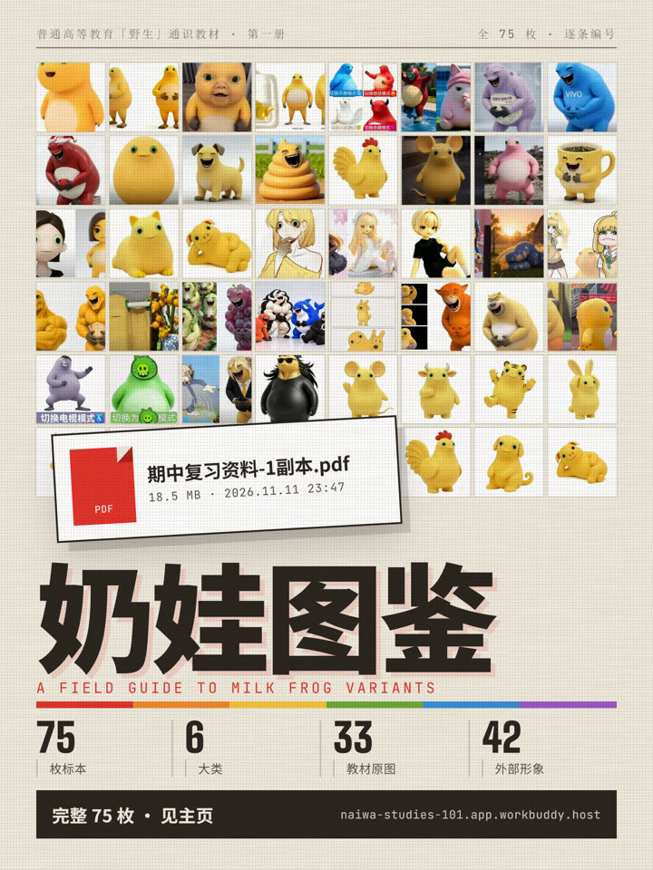

# 奶娃图鉴 · 变体识别｜必修 第一册

> 一只黄色的蛙，和由它长出来的几十种变体，按人教版高中教材的体例，一个一个认清楚。

**在线看 →** <https://naiwa-studies-101.app.workbuddy.host/?sharecode=DEX7A3FOQN>



---

## 这是什么

一个单页应用：`index.html`，无框架、无构建、无后端，112 张 webp 全在 `assets/` 里。

**75 条标本**，每条都配：形象图、图号、原图注、一句话定义、完整介绍、**出处**。
能按族群筛选、按关键词搜索、点图放大、`☆ 已认识` 打卡，末尾还有一章 20 题的随堂自测。

视觉上刻意不做成"网页"，而做成**一本能翻的教材**：Sakura 六色、半调网点、全直角、页眉页码与栏线，中英混排用 Big Shoulders Display / Albert Sans / JetBrains Mono，正文思源黑体。

配套做了一条 52 秒的介绍片，和两张可以收藏的长图。

## 成品

| 文件 | 规格 |
|---|---|
| `media/naiwa_v2_5.mp4` | 52.000s · 1080×1920 · 30fps · −13.7 LUFS / −2.1 dBTP |
| `media/naiwa_cover.png` | 2160×2880（3:4），标本墙 8 列 × 6 行 |
| `media/naiwa_atlas_poster_1080.png` | 1080×6745 竖版长图（拼版图未裁切） |

片子六幕：反差开场 → 版本考古 → 品类辨认 → 四轮迭代对比 → 真实录屏（筛选 / 打卡 / 自测）→ 入口与收尾。分镜表在 `film/V2_PLAN.md`，旁白全文在 `film/VO_LINES_minimax.txt`。

## 仓库结构

```
index.html                  发布版应用（单文件）
assets/                     112 张标本图与拼版图（webp）
archive/
  naiwa-studies.html        16 页「通识导论」版（早期的长篇版本）
  naiwa-studies-v1-kaoju.html  初稿
film/
  src/                      影片、封面、长图的页面源文件
  render.mjs                逐帧渲染器（时间轴 → MP4）
  record_ui.cjs             真实点击录屏（筛选 / 打卡 / 自测）
  shoot_cover.mjs           封面截图
  shoot_poster.mjs          长图整页截图
  audio_v2.py               配乐与音效（依 BPM 对小节线）
  mix_final.py              两遍线性 loudnorm + limiter
  build_vo_v3.py            按停顿切分旁白并落到时间轴
  add_laugh.py              片尾笑声插入点
  data/specs.json           75 条标本的结构化数据
  shots/                    影片引用的动画帧与素材
  VO_LINES_minimax.txt      旁白全文
  V2_PLAN.md                逐秒分镜表 / 删减清单 / 验收标准
media/                      成片、封面、长图
```

## 本地打开

```bash
npm run open          # → http://127.0.0.1:8080
```

或者随便起个静态服务器：

```bash
python -m http.server 8080
```

直接双击 `index.html` 也能看，但 `file://` 下部分浏览器会限制字体与 webp 加载。字体走 Google Fonts CDN，断网时降级到系统黑体，排版会松一些。

## 重做这条片子

需要：Node 18+、本机已装 Chrome 或 Edge、ffmpeg。

```bash
npm install                 # 只装 puppeteer-core，不下载浏览器
```

渲染原理是**时间轴驱动**：页面暴露 `window.renderAt(t)`，给定任意 `t` 都渲染同一帧，所以可以逐帧截图、再交给 ffmpeg 编码，成片可复现、不依赖录屏软件。

```bash
npm run stills              # 抽几帧看效果 → film/out/stills/
npm run render              # 全片无声 MP4（52s，约 7 分钟 / 4 核）
npm run cover               # 封面 2160×2880
npm run poster              # 长图 1080×6745
npm run record              # 真实点击录屏帧
```

浏览器与 ffmpeg 的位置会自动探测（Chrome / Edge 常见路径 → PATH），也可以显式指定：

```bash
CHROME_PATH="/path/to/chrome" FFMPEG="/path/to/ffmpeg" npm run render
```

音频链路分三段：`audio_v2.py` 生成配乐与音效（段落边界对齐小节线，人声段做 sidechain ducking）；旁白按 `VO_LINES_minimax.txt` 用 TTS 合成后由 `build_vo_v3.py` 按停顿切句、对齐时间轴；`mix_final.py` 用两遍线性 loudnorm 把整体压到 −14 LUFS，再在编码前加 limiter 防止 AAC 抬峰削波。片尾笑声的插入点由 `add_laugh.py` 控制。

## 关于出处

每条标本的卡片下方都有一行 `出处 ·`，写明它来自哪本教材的第几章第几图、或者哪篇外部盘点文章。教材原文、衍生材料与外部考据的完整来源索引在 `archive/naiwa-studies.html` 的最后一页（16 / 16 · 来源索引）。

代码随意取用。标本图与文字不是原创，来源就列在页面里。
